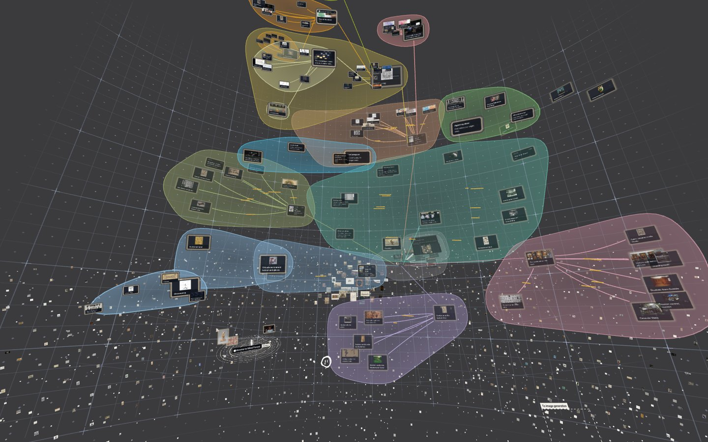
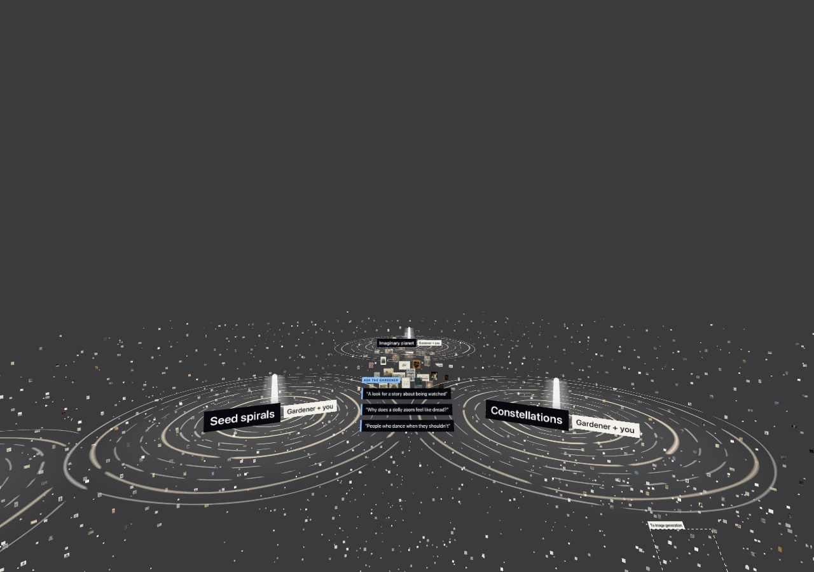
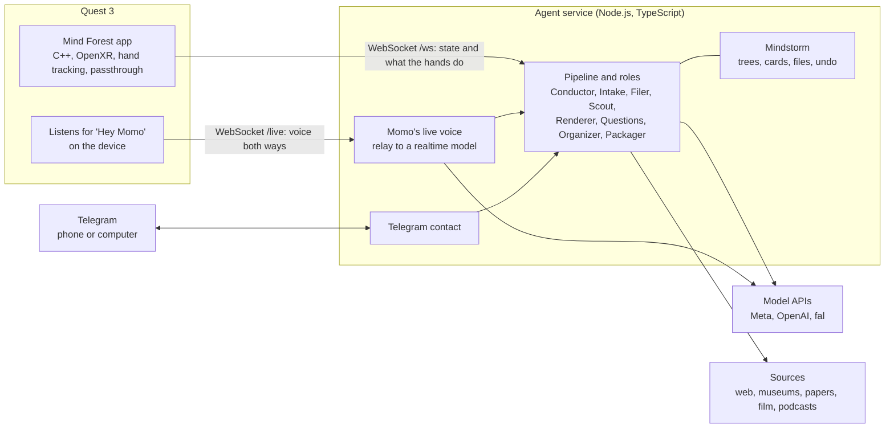

# Mind Forest

Mind Forest is a place to think in a Meta Quest 3 headset: what you save and what you ask about grows into trees of cards that stand in the room around your desk. You work with your hands, and you talk to Momo, an assistant who finds new material, answers questions and files what you send. Things get in from Telegram, and a finished tree leaves as one file that any other agent can pick up.

It is a native OpenXR app for the headset ([quest/](quest/README.md)) and a TypeScript service that runs the agents ([agents/](agents/README.md)).





## The first five minutes in the headset

This is the judging build, one app named "Mind Palace" that joins the hosted service by itself. Hands only, no controllers.

1. **Open the app and allow the microphone and the room.** The app asks for the microphone so you can talk to Momo. The first time you raise a hand it asks to see the room, so the scene can sit at your real desk. Refused, it sits at an assumed desk, and typing and picking still work without the microphone.
2. **Take the welcome tree.** On a first launch one tree stands alone, "Welcome to Mind Forest". Its eight cards are lessons, each played by a hand drawn on the card:
   - pinch a card;
   - grab to pan;
   - grab to pull or push between layers;
   - pinch and hold to move a card;
   - ask Momo;
   - show Momo part of a picture;
   - choose a layer on the small tree;
   - palms together to close.

   One line over the tree says what to do next. Pinching the next card skips a lesson.
3. **Ask Momo something.** Say "Hey Momo" (or "Hi Momo"), then what you want, such as "start a tree on Dutch still lifes". Momo answers in her own voice. Cards start to arrive round the open card within seconds, and she tells you about them as they land. While the conversation is open you can go on talking without the name, and talk over her.
4. **Work a tree by hand.** Pinch a card to open it. Pinch and hold a card until the ring fills to start a layer on it and get more like it. Pinch the open card again to go into it, where a pen, an eraser and Send to Momo let you mark part of it and ask about that part.
5. **Start from the library.** Around the desk lies the library, about 100 film scenes and 750 museum works. With no tree open, pinch one to ask Momo for a tree about it.
6. **Connect Telegram, hand off, share.** Say "connect my Telegram" and Momo gives you a bot's name and a six-digit code. After that, anything you send the bot lands in your forest. Point at a tree on the desk and two buttons appear: Send posts the tree's handoff file to your chat, and Share posts a link that grows a copy of the tree in a friend's forest.

Hold your palms together for a second to close the tree you are in.

## How it fits together



- **The headset app** draws everything and reads the hands. It holds no agent logic: it keeps a copy of the service's state, draws it, and sends what you do ([agents/docs/protocol.md](agents/docs/protocol.md)).
- **The service** runs the agents, keeps your trees, searches the sources and calls the models. The keys stay on the service and never reach the headset.
- **Voice.** The headset listens for the name on its own processor and sends nothing before it hears it. After the name, your voice streams to the service, which relays it to a realtime model that is Momo. Momo acts through tools on the service.
- **Telegram** is how things get in from a phone, and where handoffs and shared trees arrive.
- **Where the service runs.** On a Mac beside the headset, reached over the USB cable, for development. On Fly.io for judging, with a separate space for each headset and daily limits. A second small Fly app runs the scripted walkthrough used to record the film.

## What is in the repository

| Folder | What it is |
|---|---|
| [quest/](quest/README.md) | The headset app: C++ on OpenXR with its own OpenGL ES renderer, the Android project, a Mac preview window, and the tools that build, install and measure it |
| [agents/](agents/README.md) | The agent service: the roles and the pipeline, Momo's live voice, the Telegram contact, sharing, the hosted mode, and a browser client used during development |
| [agents/deploy/](agents/deploy/README.md) | Scripts that put the service on Fly.io and operate it |
| [agents/demo/](agents/demo/README.md) | The scripted walkthrough for recording the film, with four example trees ([showcase/](agents/demo/showcase/README.md)) |
| [media-src/](media-src/README.md) | The app's own media that is kept in git: sounds, fonts, the hand model, Momo's recorded lines |
| `library/` | The library the app shows: the film scenes (`clips`), the museum works (`works`), its index (`ocean.json`), and the tools that built the first two (`tools`). See Media and credits |

The names in the code are older than the product's name. The apps install as "Mind Palace Ocean" and "Mind Palace", and the service's settings begin with `MIND_PALACE_`.

## Build and run

Each part has its own README with the details. The short version, on a Mac:

**The service**, with no model and no cost (scripted agents):

```bash
cd agents && npm install && npm run dev:fake
```

With real models, put the keys in the env file ([agents/README.md](agents/README.md) lists the variable names) and run:

```bash
cd agents && npm start
```

**The app in a window on the Mac**, without a headset (needs GLFW):

```bash
quest/tools/fetch-voice.sh
quest/desktop/build.sh
quest/desktop/preview -demo
```

**The app on a headset**, over USB with developer mode on (needs the Android SDK, NDK 27.2 and JDK 17):

```bash
quest/tools/run.sh --build
quest/tools/push_media.sh
quest/tools/agent.sh usb
```

The first command builds and installs the app, the second copies its media to the headset once, and the third starts the app joined to the service on the Mac.

**The judging build**, one APK with its media inside that joins the hosted service:

```bash
quest/tools/judge.sh
```

It needs a signing key and the hosted service's address in files outside the repository ([quest/README.md](quest/README.md), The judging build).

**The hosted service:** [agents/deploy/README.md](agents/deploy/README.md).

**Tests:**

```bash
cd agents && npm test
quest/core/agent/test/run.sh
```

The repository uses Git LFS for the library's films and pictures and the demo's media. Run `git lfs pull` after cloning, or those files are short text stubs.

## Team

The git history has two authors:

- **Xinran Li**: 829 commits
- **Kaifeng Wu**: 32 commits

Counts are of `git shortlog` at this commit.

## Media and credits

What the repository itself records about third-party material:

| What | Where | Source and licence as recorded |
|---|---|---|
| Film scenes, 100 | `library/clips` | From the Condensed Movies dataset (Bain, Nagrani, Brown, Zisserman, ACCV 2020), one scene per film, short excerpts, taken for an academic, non-public demo |
| Museum works, about 750 | `library/works` | From the open collections of the Met, the V&A, the Art Institute of Chicago and the Cleveland Museum of Art, and MoMA's published dataset. MoMA's pictures are mostly in copyright |
| Fraunces 72pt Soft Light and its italic | `media-src/quest/fonts` | SIL Open Font License 1.1, copyright 2020 The Fraunces Project Authors. The notice is beside the files |
| Eraser and send icons | `quest/core/ocean/icons.h` | Lucide, ISC License |
| Keyword spotter | fetched into `quest/vendor` by `quest/tools/fetch-voice.sh`, not in git | sherpa-onnx (k2-fsa), Apache-2.0 |
| The walkthrough's pictures and one film | `agents/demo/media` | Many are other people's work, in copyright or of unknown rights. [agents/demo/README.md](agents/demo/README.md) says to clear each one before a public cut |
| The four example trees | `agents/demo/showcase` | Pinterest pins of unknown rights, and found pictures that are public domain or openly licensed. Each card in `tree.json` records its licence, credit and page |
| Sounds | `media-src/quest/sounds` | The project's own, synthesized by `quest/sound/synth.py` |
| Momo's recorded lines | `media-src/quest/voice`, `agents/demo/voice` | Recorded from the realtime model's voice |

The repository has no licence file of its own.
