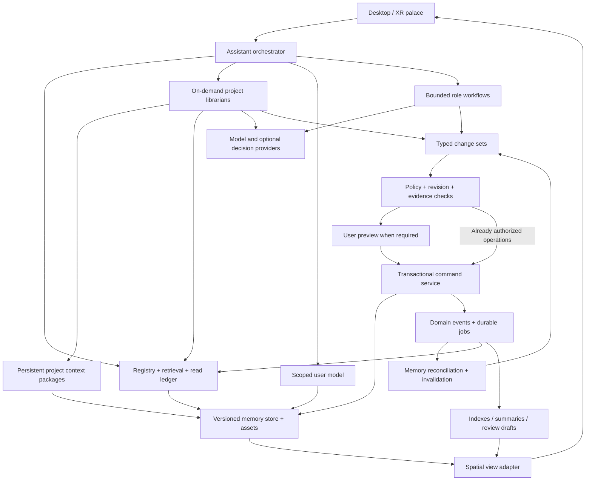

# Mind Palace: AI agent system plan

Research-informed planning draft · revised October 25, 2026

## 1. Product direction

Build a librarian that helps someone capture an experience, find their own ideas, think across them, and return to what matters. Its work should become visible through the palace: sources brought forward, relationships explained, paths saved, and proposed changes previewed in place.

The user interacts with one coherent assistant. Behind it, specialized workflows share the same knowledge store, evidence rules, and change system. A role is a bounded responsibility; it does not require an always-running agent or a separate model.

As the palace grows, give each established project a persistent context package and an on-demand project librarian. Keep canonical memories shared, with scoped retrieval and centralized writes. Manage memory through an explicit lifecycle, and personalize through a contextual, evidence-backed user model. The three design decisions are: **persistent project continuity, selective memory activation, and revisable personalization**.

The first product should answer three questions well:

1. **Where did I put this, and what did I actually say?**
2. **How does this connect to what I already know?**
3. **What changed in my thinking, and what deserves another look?**

Working assumptions: start with a single user's private palace; keep the existing Three.js client; support desktop as a companion surface; validate one target headset early; permit provider-neutral AI through a service; make background schedules opt-in. Device choice, hosting, and collaboration remain product decisions.

## 2. What the project already provides

The implementation is a Vite/Three.js browser prototype. Its design document describes a broader XR product; those aspirations should be separated from shipped behavior.

| Existing implementation | Implication for AI |
| --- | --- |
| `src/data.js` creates 40 images and 12 notes, repeated into 200 visual nodes. | Extend the useful distinction between content and visual instances. Repeated appearances must never count as independent evidence. |
| `src/app.js` exposes group/focus navigation, Explore, path picking, cross-links, and saving a chain. | An assistant can operate through these concepts and return navigable results. |
| `src/layout.js:computeRelated()` ranks by tag overlap, chain recency, cross-links, and seeded variation. | Replace or augment the retrieval input while keeping spatial presentation deterministic. |
| Groups, drag placements, and constellations live in memory. IDs are array indices. | Durable identity, persistence, revision history, and undo are prerequisites for meaningful agent writes. |
| A node has one group. | Multi-membership requires a new relationship model; it is proposed in the design notes but not implemented. |
| Labels/HUD use DOM; regions and connections use 2D canvases. Camera/input are desktop driven. | A headset version needs XR presentation/input work beyond enabling a stereo renderer. |
| The 4096-pixel atlas has 64 cells: 40 images plus two cells for each of 12 notes. Mesh capacity is allocated at construction. | New notes need a dynamic rendering/capacity strategy. Arbitrary AI text cannot simply be appended to the demo arrays. |

There is no existing AI client, backend, document importer, persistent database, search index, transcript pipeline, durable job queue, or WebXR session implementation.

## 3. Five user experiences

Expose these experiences instead of making users manage an organizational chart of agents.

| Experience | Example request | Spatial result |
| --- | --- | --- |
| **Capture** | “Remember this, and connect it to my interface project.” | A source-backed draft arrives in an inbox; likely destinations appear as placement suggestions. |
| **Explore** | “Show me what connects these two ideas.” | Existing memories rise into a temporary constellation, with an explanation for each connection. |
| **Think** | “Help me test this idea.” | Claims, supporting sources, counterexamples, and open questions form a working path. |
| **Review** | “What mattered this week?” | A short review opens as a walkable trail through the events and original memories behind it. |
| **Maintain** | “Clean up this topic.” | Proposed merges, renames, links, and moves appear together for inspection and selective acceptance. |

The assistant should ask which kind of help is wanted when it matters: recall, synthesis, challenge, or new research. A request for recall should not silently expand into internet research or speculative idea generation.

For example, the user selects two memories about interface design and says, “Why do these feel connected?” The assistant shows the selected scope, retrieves related sources, and brings three cited candidates forward. The user inspects a passage without changing the graph, chooses one candidate for the working path, rejects an overstated connection, and saves a constellation with their own conclusion. A later review can resurface that conclusion and its original evidence.

Onboarding can begin with three questions: “What should this palace help you do?”, “Which memories may AI use?”, and “How much help do you want with organization?” A topic starter then asks about the outcome, current familiarity, and boundaries of that particular topic. Both flows should permit a useful small start without a long questionnaire.

## 4. Keep a stable palace underneath changing relevance

The current prototype makes depth express relevance. That is valuable for exploration, but long-term spatial memory also needs recognizable places.

Separate three things:

1. **Identity and meaning:** the memory, its revisions, sources, and semantic relationships.
2. **Home and membership:** where the user placed it, which topics it belongs to, and other saved appearances.
3. **Session presentation:** temporary depth, size, highlights, ranking, and working-path placement.

A note can belong to several topics, appear in several constellations, and still have a deliberate home. Bringing it forward in Explore does not move its home. Closing a session restores the saved arrangement. Pinned homes and landmarks must survive group growth and automatic layout calculations.

Use explicit commands for persistent movement. “Show related ideas” creates a temporary lens; “save this arrangement” creates placements; “move this to the design room” changes a home. Before a broad reorganization, show the proposed positions and provide undo.

Do not overload depth with every meaning. During exploration, depth means relevance to the current question. Confidence, authorship, age, and stale status use readable badges or an inspector. Use restrained line styles and labels for relationship types, with detail on focus rather than a permanent web of lines.

## 5. Shared knowledge model

The graph is a durable data model that also powers the view. It must remain usable when a memory is outside the field of view, filtered out, archived, or represented only by metadata.

### Core records

| Record | Required information |
| --- | --- |
| **Memory** | Stable UUID, kind, title/body or asset reference, revision, author/origin, created/modified times, applicable belief/decision dates when known, lifecycle status, sensitivity/AI scope. |
| **Source** | Original file/URL/import ID, content hash, captured time, extraction status, transcript/OCR revision, retrievable spans or time ranges. |
| **Topic/project** | Stable ID, name and aliases, purpose, memberships, optional navigation summary. |
| **Project context** | Goals, constraints, decisions, open questions, important source references, local preferences, lifecycle, summary revision and processed-event checkpoint. |
| **User-model entry** | Subject, scoped statement/preference, explicit or inferred origin, evidence IDs, applicable dates, confirmation/expiry status, sensitivity/allowed uses, exclusions, last correction. |
| **Relation** | Stable endpoints, relation type, author, status, evidence references, source revisions, rationale. |
| **Placement** | Memory ID, palace/view ID, home or secondary appearance, anchor/slot/transform, pinned state. |
| **Constellation** | Ordered memory references, explicit edges, annotations, session question, saved layout, revision. |
| **Session/run** | User intent, scope, sources read, decisions, open questions, artifacts, workflow/profile/playbook/policy revisions, status and budget. |
| **Derived artifact** | Summary/review/caption/embedding, exact upstream IDs and revisions, generation version, current/stale status. |
| **Change set/event** | Typed operations, actor, expected revisions, provenance, before/after references, causation ID, commit status and undo information. |

Relations should distinguish organizational membership from semantic claims. Start with a small vocabulary: `belongs_to`, `references`, `supports`, `contradicts`, `develops`, `derived_from`, and `supersedes`. For an apparent contradiction, store an evidenced candidate relation until reviewed; disagreement may depend on time or context.

Separate **authorship** from **acceptance**. An AI-written paragraph remains AI-authored after the user accepts it. A user can adopt it without erasing its origin. An unreviewed AI suggestion is not an established fact about the user.

Maintain three complementary views over these records:

- A complete, paginated registry of accessible content and locations.
- Typed graph relationships and source dependencies.
- Search indexes: exact/keyword search first, semantic retrieval when useful.

A dedicated graph database is unnecessary for the first version. Tables for records and edges are sufficient. Embeddings are rebuildable indexes, not the source of truth.

## 6. The three maps and the creation contract

The [AI OS guide](https://www.linkingyourthinking.com/ai-os-full-setup-guide) uses portable personal context, a vault map, and a skill map. Adapt that pattern to structured records with readable, exportable documents. These are the user's configuration and knowledge, independent of the model provider.

| Document/view | Purpose | Maintenance rule |
| --- | --- | --- |
| **`User.md`** | A compact view of confirmed global preferences and goals, with links to project-scoped context. | Export from structured entries; keep tentative inferences and temporary intent separate. |
| **`Navigation.md`** | Palace/topic overview, landmarks, aliases, inboxes, creation destinations, and links to scoped indexes. | Generate IDs, counts, and location links from the store; preserve separately authored navigation guidance. |
| **`Skills.md` + individual playbooks** | Available workflows, invocation phrases, allowed tools/scopes, outputs, and examples. | Versioned registrations; playbook changes are reviewed and cannot grant new permissions. |
| **Creation templates** | Rules for captures, meeting notes, topic starters, reviews, and proposals. | Define required fields, source handling, destination, naming, and acceptance criteria. |

For scale, `Navigation.md` is the front door to a hierarchy of topic and room manifests; it should not become an enormous prompt containing every note. The deterministic registry remains complete even when summaries are compact.

Readable files and the app must have one reconciliation path. Recommended: structured records are canonical; Markdown is an export and supported import/edit surface. An external edit becomes a validated proposed update against a known revision. Avoid maintaining two independently authoritative versions.

### Learning about the user over time

Use a contextual user model rather than a single expanding biography:

| Layer | Example | Update behavior |
| --- | --- | --- |
| Explicit global contract | “Keep my chosen locations stable.” | Record direct instructions; edit or revoke immediately when requested. |
| Project preferences and expertise | “For this research project, keep methodological detail.” | Apply within that project; generalize only with evidence or user instruction. |
| Current intent and temporary conditions | “Today I only have ten minutes.” | Apply to the current interaction or defined interval, then expire. |
| Tentative patterns | “Often chooses diagrams when comparing architectures.” | Store as a scoped hypothesis with provenance; use cautiously for low-impact presentation choices. |
| Assistant performance knowledge | “This workflow produces too many cleanup suggestions.” | Improve an evaluated workflow or ranking policy; do not turn it into an identity claim about the user. |

Resolve applicable preferences in this order: current explicit request, current project instructions, confirmed global preferences, then tentative patterns. Permissions remain an independent constraint at every layer. Expertise is topic-specific and can change; avoid one global novice/expert label.

The learning loop is `observe → propose a scoped candidate → compare with existing entries → apply or ask where useful → observe outcome → revise or retire`. Strong evidence includes a direct correction or preference statement. A deliberate edit is informative within its task. A click, accepted suggestion, pause, or gaze is ambiguous; absence of complaint is not approval. Several summaries of one episode remain one piece of evidence.

Resolve who a statement is about before storing personal context. A friend's preference, a quotation, roleplay, or a hypothetical example is not automatically about the user. Record the subject and the type of evidence.

Within an enabled personalization scope, the system may retain labeled hypotheses and try reversible, low-impact formatting adaptations with a simple correction control. This does not mark a hypothesis as confirmed. Promotion into confirmed personal context requires review or an explicit user instruction; avoid automatic sensitive-trait inference. Store evidence strength and conflicts rather than trusting an LLM's self-reported confidence score. A changed preference supersedes the applicable entry while preserving dated history; ambiguous differences remain scoped alternatives.

For example, repeated requests for shorter daily reviews can teach the system a **review-format preference**. They do not justify labeling the user as someone who dislikes detail. The same user may want a long technical design discussion. “Only for this project,” “not anymore,” and “that assumption is wrong” should be first-class feedback actions.

Provide a “What the librarian knows” inspector showing confirmed entries, tentative assumptions, their scope, sources, dates, and actual influence on a response. Support correction, expiry, exclusion, and forgetting through the same dependency-aware deletion path as other memories. Avoid automatically inferring sensitive personal traits from patterns.

Feedback should distinguish “wrong fact,” “wrong context,” “outdated,” “not now,” “too repetitive,” “useful connection,” and “prefer this format.” These have different effects: temporary dismissal changes timing; correction invalidates a claim; a local preference changes local behavior. Preserve a deliberate discovery/challenge mode that searches for counterevidence and unfamiliar connections. User preferences may shape vocabulary and presentation; they do not determine factual correctness. Store “the user believes X” separately from evidence that X is true.

This design is an inference from the evidence, not an established optimal user model. [LaMP](https://aclanthology.org/2024.acl-long.399/) demonstrates the value of retrieving relevant user history on its personalization tasks. [PERSONAMEM](https://arxiv.org/abs/2504.14225) tests changing profiles and preferences, using simulated histories. Neither establishes longitudinal understanding of a real person. A [CHI 2026 study](https://arxiv.org/abs/2509.12517) found that user context can increase agreement-seeking behavior; a [structured-memory study](https://arxiv.org/abs/2608.08300) reports reduced cross-domain leakage in its benchmark when memories are partitioned by domain. Evaluate helpfulness and factual candor separately.

Begin learning through editable memory, retrieval/ranking, and tested playbook changes. Per-user model fine-tuning is a later experiment if held-out results justify it; it complicates inspection, correction, and removal. The system should improve at helping this person while keeping the source of each adaptation accessible.

## 7. Specialized roles

The librarian routes user intent to these workflows. Each invocation receives a bounded scope, source-reading contract, allowed operations, budget, and definition of done.

| Role | Trigger and inputs | Output and write boundary |
| --- | --- | --- |
| **User builder** | Onboarding, explicit “remember this about me,” or a proposed preference change. Reads approved profile plus relevant statements. | A small profile patch with source/date. Explicit instructions can be recorded within scope; inferred candidates stay tentative until reviewed for promotion. |
| **Project librarian** | A scoped project question, meaningful project changes, or an enabled review. Reads its project context and relevant canonical sources. | Resumable project understanding, evidenced answers, and proposed project changes; no independent global user profile. |
| **Memory curator** | New evidence, correction, permission change, or consolidation job. Reads candidates, lineage, and affected memory entries. | Typed add/update/supersede/reject/invalidate operations through the command service; explicit ambiguity where evidence conflicts. |
| **Navigation builder** | Import, membership/location changes, or requested audit. Reads the registry and authored organization rules. | Regenerated manifests plus proposals for ambiguous topic labels. IDs/counts/links are maintained by code. |
| **Skill builder** | User describes a recurring way of working. Reads approved playbooks and examples. | Draft playbook with triggers, steps, tools, output schema, failure behavior, and evaluation examples. Activation is explicit. |
| **Note taker / chronicler** | Explicit capture, imported transcript, or a saved assistant session. | Original source plus separate summary, decisions, unresolved questions, and proposed tasks/links. Never fabricates speaker identity, agreement, or a task owner. |
| **Daily reviewer** | Manual invocation or an enabled schedule. Reads new source events since its checkpoint, changed notes, and capture/session records. | Timestamped daily log, concise review, and a separate list of unresolved items. Does not turn every observation into a task. |
| **Weekly/monthly reviewer** | Manual invocation or an enabled period review. Reads lower-level reviews, active projects, and selected original evidence. | Changes in direction, recurring themes, carried questions, and proposed priorities. Reports missing days and weak evidence. |
| **Topic starter** | “Help me start learning/thinking about X.” | A starter constellation: goal, boundaries, existing knowledge, central questions, and a small next-step set. Asks a few high-value questions before assuming the topic's meaning. |
| **Thinking partner** | A question, selected memories, or a working path. | Evidence-linked synthesis, challenges, alternatives, and questions. Captures the user's conclusion separately from its own suggestions. |
| **Connection/content suggester** | User request or a limited, enabled discovery pass. | A few explained links, resurfaced memories, or labeled external leads. Dismissals and “not now” affect repetition. |
| **Cleaner / maintainer** | Requested cleanup or a bounded integrity scan. | A reviewable change set for duplicate candidates, broken links, inconsistent metadata, stale derivatives, and proposed moves. No silent broad rewrites. |
| **Verifier** | Before committing a change set or publishing a substantive review. | Structural checks and an evidence audit; may send a run back for missing sources or unsupported claims. It has no authority to expand permissions. |

Use parallel agents where perspectives or independent scopes help: a thinking partner and a critic, or independent topic summaries during a full review. Keep each reviewer's evidence visible. Start with shared workflow code, not a large collection of permanently chatting agents.

### Project-specific librarians

Yes: each meaningful project should have durable continuity. The persistent element is its context package; an agent runs when there is relevant work. A tiny project can use scoped retrieval directly. A larger project can use a specialist with its own working context. Avoid assigning a separate autonomous agent to every tag or visual group.

A project context package contains purpose and success criteria, constraints, current decisions with rationale and dates, unresolved questions, local vocabulary, source IDs, local working preferences, saved constellations/landmarks, recent changes, and a processed-event checkpoint. Its brief is a navigational cache with source links, not a substitute for the underlying evidence. Store the revisions and last refresh time.

Route a simple project question to one retrieval workflow; a deep project question to a specialist; a cross-project comparison to bounded independent specialists plus synthesis. “Where else have I thought about this?” also searches the global accessible index, so an early routing mistake cannot silently hide other rooms. Show the current scope and let the user broaden it.

Specialist handoffs include findings, source IDs/revisions/passages, coverage, exclusions, unresolved questions, and proposed changes separately. The lead librarian can reopen important evidence. Deduplicate sources shared by several projects. All specialists use one canonical store and command service; permissions and concurrent revision checks apply before read, answer, and commit.

Project lifecycle: candidate grouping → active → paused → archived. Establish projects through purpose or explicit choice, not note count alone. Active projects can have enabled maintenance; paused/archived projects keep their landmarks and searchable sources without routine model calls. An archived project can be consulted on demand. Splits and merges preserve memberships and redirects.

This is a design recommendation, supported indirectly by [Anthropic's deployed research architecture](https://www.anthropic.com/research/multi-agent-research-system) and [controlled agent-scaling experiments](https://arxiv.org/abs/2512.08296v3): independent subtasks can benefit from delegation, while coordination adds cost and task-dependent failure modes. Their results do not prove that a specialist is better for every personal project. Compare a well-designed single-agent baseline, project-context loading, and actual delegation at comparable budgets before increasing complexity.

## 8. Retrieval and honest coverage

The user's concern about random samples is fundamental: knowing that a note exists, finding it, reading its summary, and reading its full content are different states. A graph alone does not establish completeness.

### Different questions need different retrieval

| Question | Strategy |
| --- | --- |
| “Where is the note about X?” | Exact/alias and keyword search, with semantic fallback. |
| “What led to this decision?” | Traverse dated decisions and source-linked relationships, then read supporting episodes. |
| “What themes span my projects?” | Search project/topic summaries, synthesize across relevant groups, and reopen important originals. |
| “Review every note in this room.” | Exhaustive scoped enumeration and batched reading with coverage accounting. |

[GraphRAG](https://arxiv.org/abs/2404.16130) provides evidence for hierarchical summaries on global sensemaking questions in its evaluated corpora. It does not establish that every recall query needs a graph traversal. A [controlled dialog-memory analysis](https://arxiv.org/abs/2601.01280) also cautions that representation and retrieval settings account for substantial differences between systems. Keep explicit graph relations for navigation, provenance, and reasoning, while evaluating retrieval against a strong hybrid-search baseline.

Fuse keyword and semantic candidates, apply project/time/permission filters, expand a bounded set of useful graph neighbors, rerank, and retain diverse evidence. Preserve important older decisions rather than ranking everything by recency. When an index is stale, include its unindexed delta or disclose the gap. Daily and project summaries narrow navigation; direct source retrieval remains available for details omitted by summaries.

### Retrieval sequence

1. Resolve the requested scope: selected notes, constellation, topic, date interval, or whole accessible palace.
2. Read a manifest at a known registry revision. Record exclusions, access limits, and extraction failures.
3. Find candidates through IDs/aliases, keyword search, graph neighborhoods, and optional embeddings. Deduplicate by canonical memory/source identity.
4. Read the relevant content, including original passages or transcript intervals when needed. Record exact source revisions and spans.
5. Search for contrary evidence and alternative topic interpretations when synthesizing an answer.
6. Return cited conclusions and explicit gaps, alongside the nodes to present spatially.

For a scoped question, selective retrieval is appropriate. For “review everything in this room,” enumerate every eligible record with cursor exhaustion and process all content in batches. For a large palace-wide audit, use a resumable background job and disclose partial completion. Never relabel a top-K search as a complete review.

### Run coverage record

Record `scope`, `registryRevision`, `expectedRecordIds`, `discoveredIds`, `readIdsAndRevisions`, `readMode` (metadata/summary/excerpts/full), `failedOrExcludedIds`, `indexRevision`, and `continuationCheckpoint`. For long sources, include expected and processed chunks or time ranges.

For delegated batch work, record which worker read each source and which evidence artifact it returned. A coordinator that sees only summaries should describe that aggregated coverage accurately rather than claim direct full-text inspection.

Example user-facing report: “42 notes in scope; 39 fully read, 2 read as summaries, 1 unavailable.” Counters come from tools. A summary read does not increment the full-read count. Completing an enumeration proves the scope was traversed; it does not prove that a model interpreted every passage correctly.

For a complete review, pin both the registry and eligible source revisions to a coherent snapshot, and identify its time in the result. If that is unavailable, report an “as read” review with changed-since-start items and reconcile those changes before claiming current coverage. Account for indexing lag through a matching index revision or a scan of unindexed changes. A snapshot never overrides a later access revocation.

Every factual answer about the palace should link to the underlying memory and a passage/revision when practical. In VR, selecting the citation opens that source beside the claim and offers “show its home.” Generated hypotheses carry a different label. An unsuccessful search should be phrased within the accessible scope, not as proof that the user has never thought about something.

## 9. Agent execution and the Jev idea

Use a typed workflow loop:

`understand → scope → retrieve → propose → verify → present/commit → record`

At each step, application code validates allowed tools, arguments, resource access, source versions, and budgets. Model output is a proposal to the runtime.

There are three kinds of work:

| Work | Recommended executor |
| --- | --- |
| IDs, permissions, pagination, revision checks, invalidation, persistence, scheduling | Deterministic application code. |
| Bounded classification or routing, such as capture type or which workflow fits | Rules first; optionally a small structured model or decision model. |
| Synthesis, disambiguation, explanation, critique, and drafting | A reasoning/generative model with scoped tools. |

[TypeSafe describes Jev](https://typesafe.ai/blog/introducing-system-one-models-and-jev) as producing typed probabilistic decisions. It could be evaluated for routing, candidate relation classification, or deciding when to request a deeper review. The [linked article](https://medium.com/@patriwala/jev-opus-5-5-why-your-coding-agent-needs-two-kinds-of-thinking-46f641eb6a0f) provides an architectural example of pairing decision and generative work.

Keep Jev optional behind a decision-provider interface. Benchmark it against rules and a structured-output model on actual palace examples before adding another dependency. Valid output types and high model scores do not establish factual correctness or authorize an action. Set automation thresholds from measured errors and acceptable consequences, with abstention for ambiguous cases.

Each run stores its objective, accepted decisions, unresolved questions, evidence references, job status, and useful failure/feedback records. This task state is separate from conversation history and from durable facts about the user. Store inspectable actions and decisions rather than private model reasoning.

## 10. Capture, review, and memory consolidation

### Capture

Keep source capture and interpretation separate. An audio clip, transcript, photo, imported note, and assistant conversation can all be source records. Extraction may fail or be incomplete; show that state rather than implying the source was read.

An explicit save should be immediate even if AI is offline. Summaries, suggested memberships, and links can arrive later. Start with pasted text, Markdown imports, and saved assistant sessions. Add recording and environmental capture after the headset/input path is validated. Recording has an explicit control, visible indicator, retention choice, and a way to exclude a private passage.

### Memory types and lifecycle

Memory type and storage tier are different dimensions:

| Memory type | Examples | Main control |
| --- | --- | --- |
| Working | Current question, selected notes, plan, pending tool results. | Bounded context; preserve useful checkpoints before compaction. |
| Episodic | What happened in a session or meeting, with original sources. | Dated, attributable evidence; retains qualifications and context. |
| Semantic | Current project facts, confirmed preferences, definitions. | Source-linked entries with scope, revision, and applicable dates. |
| Procedural | Approved ways to run a review or organize a specific output. | Versioned playbook with tests and permission limits. |
| Prospective | A commitment, unresolved question, or thing to revisit. | Explicit state/trigger; never rely on similarity search alone for due items. |
| Spatial | Homes, landmarks, saved views, and exploration paths. | Durable identity and placement; relevance changes do not silently move homes. |

Inference candidates remain explicitly tentative within these types. These categories can share tables and indexes; they do not require six databases or six agents.

Use this lifecycle: `source captured → extraction candidate → reconcile → typed commit → index → retrieve/use → review → update/supersede/archive/delete`. Preserve the source first. Extract bounded claims, decisions, questions, and preferences with passages and applicable scope. Compare candidates with existing entries before adding or updating; exact duplicates add provenance rather than another apparent fact. A changed decision may supersede an older decision; a preference in a different project may coexist. Ambiguity stays unresolved until evidence or user clarification settles it.

The curator owns this reconciliation workflow while application code enforces structure, versions, permissions, and transactions. Reviews can nominate candidates, but generated observations do not automatically become confirmed memory. Important user corrections update the current entry and invalidate derived material promptly; they should not wait until the next weekly review.

Make reconciliation outcomes explicit: `ADD`, `LINK_EVIDENCE`, `SUPERSEDE`, `CONFLICT`, `NO_CHANGE`, or `REJECT`. A memory claim carries subject, value/relation, scope, applicable date interval, recorded time, source spans/revisions, epistemic status, and supersession/conflict links. Retrieved or frequently repeated claims do not become more credible merely through use.

Use **hot** memory for the current task and a small relevant context package, **warm** memory for indexed source-linked records and project summaries, and **cold** memory for retained originals and inactive history. These are retrieval/storage policies, not different truth levels. A cold source remains searchable and can return to active use. Compact context and consolidate derived summaries without deleting retained original evidence.

Distinguish five forms of forgetting: removing something from the current prompt, reducing proactive salience, archiving, superseding its current applicability, and deleting it. Inactivity alone should not erase a user's note or conclude that an important old decision is false. User-pinned memories and active commitments need separate handling. Temporary assumptions can expire; uncertain durable preferences can request revalidation. Explicit deletion also reaches dependent summaries, indexes, caches, and pending jobs under app control.

The emphasis on updates is supported by [LongMemEval](https://arxiv.org/abs/2410.10813), which evaluates temporal reasoning, updates, and abstention alongside recall, and [Memora](https://arxiv.org/abs/2604.20006), which reports reuse of invalidated memories in its benchmark. These motivate temporal records and retirement rules; they do not establish one universally best consolidation schedule.

### Review hierarchy

`original sources + changes → daily log/review → weekly review → monthly synthesis`

Daily logs are chronological observations. Reviews are interpretations. Backlog items are possible actions with an explicit unresolved/resolved state. Keeping them separate prevents the system from treating all activity as unfinished work.

A daily entry includes event time, summary, source IDs, decision status, and any open question. Use real event timestamps, record the user's timezone, and handle late imports and corrections. Keep the time a belief/decision applied separate from when its note was captured, imported, or edited. An old note imported today is not automatically the user's newest position. Re-running a day should not duplicate its entries.

Advance processing checkpoints by a monotonic ingestion/event sequence, separately from the event's `occurredAt` time used for display. An older meeting imported today still gets processed and is labeled as a late arrival. Advance a completed checkpoint only after every event in its range has a recorded outcome; keep failures resumable. Historical reviews receive linked amendments or new revisions rather than silent replacement.

Weekly and monthly reviewers use the lower-level material as an index, then reopen original sources for important themes, apparent contradictions, changed goals, and carried commitments. A model's earlier summary is not independent corroboration. Preserve links all the way back to originals; count unique sources rather than repeated summaries. Missing days and unavailable sources remain visible.

Suggested review outputs:

- What was added or materially changed.
- What the user decided, versus ideas still being explored.
- Important connections and tensions, with evidence.
- Unresolved questions or commitments to revisit.
- A small proposed set of next actions, accepted individually.

Reviewing the app's recorded history does not imply access to arbitrary external conversations or other applications. Each additional capture source requires an intentional integration and scope.

## 11. Propagating changes without rewriting history

Track dependencies using `derived_from` references to precise upstream revisions, including transitive lineage to original sources. Commit a domain mutation and its outbox event in the same database transaction. A worker drains the event outbox idempotently, updates deterministic indexes, and marks affected AI artifacts stale; regeneration is a separate job. This closes the crash window between saving content and scheduling its maintenance.

| Change | Automatic maintenance | User-visible handling |
| --- | --- | --- |
| Rename a note/topic | Resolve stable-ID links, update aliases, current labels, manifests, and search. | Preview prose substitutions where context matters; retain original quotations and historical names. |
| Correct a source statement | Invalidate affected summaries, embeddings, claims, and reviews. | Show a correction or revised review; preserve the earlier version with its date. |
| Change a convention | Find matching current notes/playbooks with a bounded migration. | Review a batch patch; skip historical text unless explicitly included. |
| Move a home | Update placement and location lookup. | Animate only the accepted move; keep semantic relationships intact. |
| Merge duplicates | Redirect stable identities, preserve provenance and all placements, flag conflicts. | Preview the survivor, redirects, content choices, and undo. Similarity alone is insufficient. |
| Delete/exclude a source | Remove it from active retrieval, invalidate derivatives, cancel pending use. | Apply the selected retention/deletion policy to copies, summaries, embeddings, exports under app control, and caches; show residual history status. |
| Change AI scope or access | Invalidate affected cached responses and derived views; cancel or revalidate jobs using that source. | Apply the current source restrictions through summaries, profile context, and other derivatives before serving them again. |

Distinguish a historical snapshot from a current living summary. A review about what the user believed last month should not silently become a description of today's beliefs. Show “corrected later” or create a revised version.

Prevent propagation loops with event IDs, causation IDs, coalescing, idempotent handlers, and source-revision checks. Generated summary updates do not recursively create new “user activity.” Index bookkeeping does not re-run a whole review. Rejected suggestions stay dismissed until material evidence or user intent changes.

## 12. Permission and change model

Use one change mechanism for all agent writes. A change set contains purpose, scope, exact typed operations, expected revisions, evidence, affected derived artifacts, and preview/undo information. A stale proposal must be revalidated if the user edits a source while the agent is working.

A clear instruction identifying the object and requested change authorizes that work within its scope; avoid asking for the same permission again. Promoting proactive inferences to confirmed context and performing broad or ambiguous transformations need a reviewable proposal. Recheck current permissions and approved context before tool access and commit, including for queued jobs. Revoking a source, integration, or playbook cancels or narrows pending work and prevents cached context from being sent onward.

| Action | Default behavior |
| --- | --- |
| Search/read within the enabled AI scope; build a temporary view | Execute in the current interaction. |
| Save a capture or constellation the user explicitly requested | Commit within that request; show undo. |
| Maintain deterministic indexes, counts, and manifests | Automatic and recoverable. |
| Create an AI draft in the designated inbox | Allowed within an invoked workflow or enabled automation. |
| Store a tentative preference hypothesis or try reversible presentation adaptation | Allowed within enabled personalization scope; keep it labeled and separately inspectable. |
| Promote a proactive profile inference to confirmed context, rewrite authored text, merge, change homes, or migrate conventions | Present a concrete patch for acceptance; execute specific user-authorized changes within their scope with undo. |
| Activate/change a playbook, broaden tool access, enable an external integration | Explicit user control; playbook prose cannot grant access. |
| Send/share/publish, record other conversations, or permanently purge | A separate, explicit action with appropriate product confirmation. |

Treat imported content and transcripts as evidence, never as privileged instructions. Retrieval permissions also apply to embeddings, source excerpts, profile builders, and summaries. Check authorization again before serving cached or derived content and before releasing an in-flight answer. A private room cannot leak through an otherwise public-looking generated answer. Give users per-room/per-source AI inclusion, a clear cloud-processing setting, and retention controls.

## 13. Spatial interaction details

**A quiet librarian.** Provide a compact summon control and optional voice. Show a short answer in the scene with sources around it. Long text opens in an adjustable reading panel or desktop companion. The user can interrupt, stop, narrow the scope, or continue without speech.

**A working surface.** Selected notes and the current question form a temporary workbench. Assistant suggestions appear in a distinct preview state. Picking one adds it to the path; accepting a link changes the graph. Viewing a suggestion alone does neither.

Use a clear interaction flow: choose/inspect scope → ask → see retrieval progress/cancel → inspect answer and sources → select path items → save the session or accept a graph change. Source inspection, path selection, graph acceptance, and saving have separate effects and visible state. If the user changes the scope or path during retrieval, discard or explicitly relabel the older result.

**A review inbox.** Background work adds a small number of inspectable proposals to a consistent place. No unsolicited objects fly into the user's focus. Notifications are for useful changes or required decisions and can wait until the user next enters.

**Explained relationships.** Focus on a suggested edge to see the relation, supporting passage, and why it was surfaced now. Similarity is labeled as similarity; a substantive claim needs evidence. The user can accept, reject, or choose another relationship.

**Comparison as a spatial tool.** Keep the current claim near the center, place supporting passages on one side and challenges on the other, and let the user compare them without replacing the thought in focus. Validate this with pointer/ray controls first; two-handed manipulation can extend it later.

**Spatial recall support.** Offer “take me back,” “show its home,” and “replay how I got here.” Save the question, visited sources, selected edges, user annotations, and the final conclusion with a constellation. A path represents the user's exploration; not every adjacent pair is a factual support relationship.

A review trail works seated: bring each source forward through the same selection controls. Physical walking is optional. Preserve usable text/input alternatives for people who prefer not to speak, turn, or reach.

Give the review inbox a configurable display budget, initially a few proposals per visit. Group repetitive maintenance work and offer dismissal for a whole suggestion family. Keep a separate optional history rather than making the user clear an ever-growing proposal backlog.

**Comfort and control.** Keep landmarks stable; avoid automatic camera/head motion; use optional transitions and restore the prior view after an AI lens. Gaze can identify a candidate target but does not by itself authorize a write or become evidence of a preference. Resolve “put this there” using an explicit selected target and destination preview when ambiguous.

**Scale.** A large palace can preserve conceptual presence through topic shells and aggregates. Do not require every memory to be fully rendered or readable simultaneously. The registry/search covers all eligible content independently of the visible subset.

## 14. Implementation architecture and source seams

### Recommended first architecture

Use one service for memory commands, retrieval, job state, and model access. For a private development pilot, this can run on the user's computer with a database and local asset directory. A headset client requires a secure, reachable authenticated endpoint; localhost on the headset is not the user's desktop. A hosted service is an alternative deployment of the same boundaries. Decide the connection/deployment path in the headset spike.

For a single-user pilot, a transactional store such as SQLite with relationship tables and full-text search is sufficient; add an embedding index if retrieval evaluations justify it. Keep assets and source versions accessible through the service. Require durable client storage for new captures and saved paths before claiming offline success: client-generated stable IDs, a local outbox, visible pending/synced status, and idempotent reconnect synchronization. Cache selected existing content for offline browsing. A revision conflict preserves both versions for resolution instead of silently overwriting one. Define broader conflict behavior before adding more devices or shared editing.

Keep provider credentials on the service, outside the Vite bundle. Run AI jobs outside the render loop; heavy local extraction/index work belongs off the UI thread. Background daily/weekly work requires a persistent service or a visible “catch up next launch” policy; a closed or suspended headset browser cannot be the only scheduler.

Start with one orchestrator, a bounded worker queue, a model-provider adapter, and a tool registry. Durable jobs need checkpoints, idempotency keys, bounded retries, cancellation, resource/time/token budgets, and observable failures. Cache by source revision and workflow version. Limit graph expansion and return partial results clearly when a budget ends.

Scale work by activity and query scope, rather than total project count. Maintain incremental indexes and changed project contexts; do not ask every project librarian to reread every note nightly. Retrieve bounded candidates before model reranking, limit cross-project fan-out, and avoid all-pairs relationship generation. Keep canonical memory writes serialized or revision-checked while independent extraction/search can run in parallel. Render a bounded working set and aggregated distant topics independently of how much the memory service indexes.

### How this connects to the current files

| Current file/seam | Planned change |
| --- | --- |
| `src/data.js` | Retain demo fixtures; load canonical memories, memberships, and placements from a repository adapter. Replace durable array-index references with stable IDs. |
| `src/app.js` | Keep navigation/view intent, but route persisted changes through typed commands. Store session focus separately from domain records and animation state. |
| `src/layout.js:computeRelated()` | Accept asynchronous retrieval results containing memory IDs, rank, relation/reason, and evidence; map them to visual instances. Keep a local fallback and discard stale responses after the question/path changes. |
| `src/app.js:saveChain()` | Save a durable constellation with stable node/edge references, question, annotations, and optional layout; support reopen. |
| `organize()`, `groupSelection()`, `endDrag()` | Separate preview from committed membership/placement commands; persist and support undo. |
| `src/atlas.js`, `src/nodes.js` | Support changing content/capacity, paged or incremental textures, and a readable full-note panel. Do not use the atlas excerpt as the AI's source text. |
| `src/hud.js`, `src/overlay.js`, `src/regions.js` | Desktop views for assistant status, citations, and proposals; headset equivalents in scene space. |
| `src/input.js`, camera update, `src/main.js` | Input adapter for controller/hand rays and supported target-device inputs; respect headset pose, per-eye rendering, and angular text/detail sizes. |
| `App.on/emit` | Keep UI notifications; add durable domain events from commits for indexing, reviews, and invalidation. |

Suggested modules: `domain/`, `repositories/`, `retrieval/`, `agents/`, `jobs/`, `commands/`, and `presentation/`. These are boundaries to establish incrementally, not a requirement for an immediate rewrite.

## 15. Roadmap with exit criteria

### Step 0: durable content and a headset feasibility spike

Implement stable IDs, notes/assets, placements, constellations, revisions, save/reload, a durable local capture/path outbox, and a basic command/undo boundary. In parallel, test one target headset: stereo node rendering, readable source panel, ray selection, and the service connection. Check current shader billboarding, DOM/canvas overlays, and camera behavior on-device. Choose WebXR or a native shell based on required input/capture capabilities and the actual device result.

**Exit:** a real note and saved path survive restart; offline saves survive restart and sync once after reconnection; one note can appear in two views without duplication; the headset can select and read a memory comfortably and reach the service.

### Step 1: evidence-backed spatial librarian — the MVP

Support pasted/Markdown notes, explicit scoped preferences, project context packages for two projects, generated navigation manifests, keyword/tag/graph retrieval, a read ledger, and a single assistant interaction. Add semantic search only if the initial retrieval set needs it. Present cited answers and related nodes through Explore; save and reopen annotated constellations. Add minimal source correction invalidation from the start. Validate shared-source identity and cross-project discovery before adding delegated project workers.

**Exit:** “Find my earlier thoughts on this” retrieves real sources, opens supporting passages, reports coverage honestly, preserves homes, and saves the reasoning path. Test an honest empty result, an unavailable source, and an ambiguous “put this there.” Network/model failure preserves browsing of cached content and durable local saving; uncompleted AI work remains visibly pending or failed.

### Step 2: capture and thinking workflows

Add source-backed session summaries, the topic starter, thinking partner and optional critic, candidate relations, a memory reconciliation workflow, and a proposal inbox. Add a user-context inspector, correction controls, and project-local feedback. Evaluate on-demand project specialists against direct scoped retrieval. Add audio/transcript capture as supported by the selected device and deployment.

**Exit:** a captured conversation produces a useful draft with traceable decisions and unresolved questions; a thinking session distinguishes user conclusions from generated suggestions; rejected proposals do not recur immediately.

### Step 3: scheduled consolidation

Add event checkpoints, daily logs/reviews, weekly and monthly synthesis, missing-period reporting, and a walkable review trail. Start with manual “review today” before scheduling the same workflow.

**Exit:** retries create no duplicate entries; an interrupted job resumes; major review claims lead to originals; missing days and later corrections remain visible. A closed headset has defined scheduling behavior.

### Step 4: controlled maintenance and personalization

Add rename/merge/convention migrations, dependency-aware propagation, evidence-backed preference hypotheses, evaluated ranking/playbook adaptation, editable skills, and an evaluated fast decision provider if useful. Permit narrowly scoped automatic actions based on demonstrated acceptance and error rates. Essential explicit preferences and corrections are already supported in earlier steps.

**Exit:** a batch change is previewable, conflict-checked, reversible, and reflected consistently in search, navigation, sources, and current derivatives. Historical snapshots remain interpretable.

Defer broad autonomous organization, always-on environmental recording, automatic skill activation, multi-user graph editing, and many independent agent processes until the core loop is useful and reliable.

## 16. Evaluation and product decisions

Build a small, representative evaluation palace containing aliases, near-duplicate notes, negations, changed opinions, dated decisions, incomplete transcripts, multi-topic memberships, and restricted sources. Keep expected evidence and acceptable abstentions with each test case.

| Quality | Evidence to collect |
| --- | --- |
| Retrieval | Known sources found, irrelevant results, cross-topic recall, and whether citations actually support the answer. |
| Coverage honesty | Exact tool-derived counts; incomplete jobs and excerpt reads never reported as full review. |
| Knowledge integrity | AI hypotheses remain labeled; two summaries of one source do not count as two sources; correction/deletion invalidates affected derivatives. |
| Spatial value | Time to return to a remembered source, landmark stability, ease of inspecting evidence, and usefulness of a saved path compared with a simple result list. |
| Automation quality | Accepted/edited/rejected proposals, duplicate log entries, repeated dismissed suggestions, successful resume and rollback. |
| Runtime quality | Measured response latency, job cost, cancellation behavior, and headset frame-time/comfort on the selected hardware. |
| Scope enforcement | No restricted source returned through a summary, embedding, profile update, or generated answer; no stale proposal overwrites a newer edit. |
| Personalization | Helpful adaptation on future held-out interactions, correction success, temporary-preference expiry, cross-project appropriateness, and factual candor. |
| Project specialization | Compare direct retrieval, project-context loading, and delegation with equivalent tools and budgets; measure cross-project misses, duplicate work, and coordination cost. |

Evaluate learning chronologically: learn from earlier interactions and test on later interactions without exposing their answers during memory construction. Include “concise for daily reviews, detailed for research,” a temporary constraint that expires, a changed preference, a false candidate inference, a friend's preference in quoted text, a user claim contradicted by evidence, a source shared across projects, an archived project, and a revoked source. Compare explicit-profile-only, relevant-example retrieval, and candidate-pattern adaptation. Optimize for task success, reduced correction burden, and user control; engagement and acceptance rates alone reward the wrong behavior.

Hard invariants should include stable identity, source-linked generated claims, version-checked commits, explicit partial coverage, and preserved pinned homes. Measure numerical targets after a representative corpus and headset are selected; do not assume vendor benchmarks describe this workload.

Recommended defaults for the remaining decisions:

1. **Primary job:** recovering and developing the user's own ideas. External discovery is a separate, labeled mode.
2. **Experience:** one librarian, five user-facing modes, specialist workflows behind it.
3. **Memory model:** canonical records plus multiple spatial appearances and temporary relevance lenses.
4. **Autonomy:** automatic indexing and requested captures; drafts/proposals for interpretation and organization.
5. **Storage:** a private single-user service first, with portable Markdown/JSON/asset export. Define a cloud or desktop deployment before headset integration.
6. **Device:** select one real headset for the first slice; do not assume eye tracking, passthrough capture, or a native filesystem exists on every target.
7. **First demo:** create a real note → ask a grounded question → inspect sources in space → select a connection → save a constellation → restart and reopen it.

A later product branch is deliberate recall practice: ask the user to reconstruct a relationship or route before revealing the saved path. Decide whether strengthening unaided recall is a separate goal; it requires different interaction design and evaluation from helping someone retrieve and develop ideas.

The first implementation backlog should follow that final loop. It establishes the memory substrate, evidence contract, spatial interaction, and useful AI behavior before adding broad background agency.
