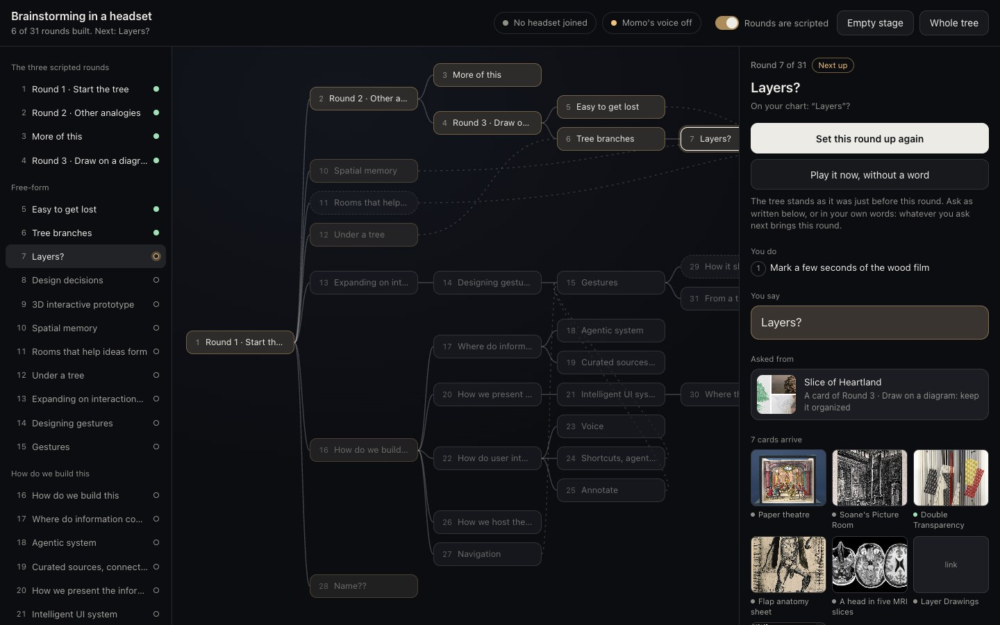
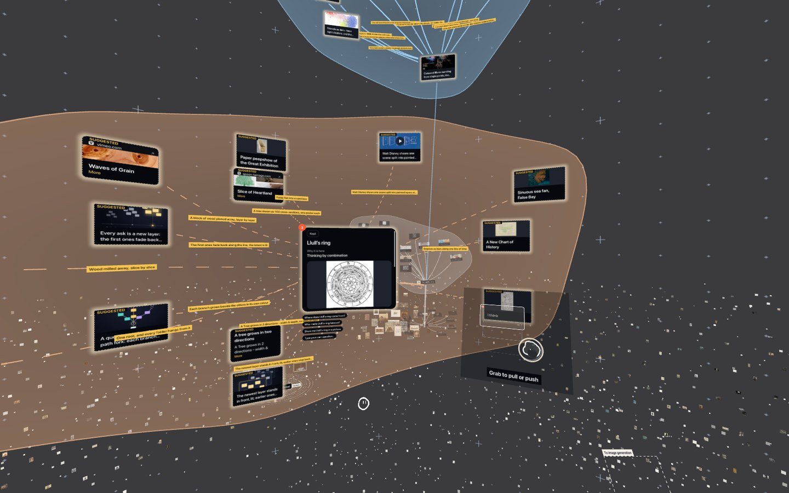

# The walkthrough demo

One prepared tree, "Brainstorming in a headset", for recording the film. It is the walkthrough board made real: 31 rounds of asking, 149 cards, each round a layer of the tree.

- You go to any round from a page on the Mac. The tree then stands on the headset as it was just before that round, and you record from there.
- You talk to Momo as usual. Momo hears you and answers in her own words. What the Scout brings is fixed: the round's cards, in the same order every time, under the same "Scout is searching" labels as a real search.
- Nothing in the app is special-cased. The cards are ordinary cards (pictures, artworks, papers, notes, links), drawn by the app's own card system.




## Where it is

The demo is on the branch `demo/walkthrough`, cut from `tracy/agents` as it stood on 2026-11-16 (8204c58).

- **On Kai's Mac** it is already checked out, in a second folder beside the main one, so the main folder and the work under way in it are left alone:

  ```bash
  cd <the demo's folder>
  ```

  Every command below is run from that folder. A release APK built from it on 2026-11-16 is at `quest/android/app/build/outputs/apk/release/app-release.apk`.

- **On another Mac:**

  ```bash
  git fetch origin && git switch demo/walkthrough && git lfs pull
  ```

## Set up, once

1. **Keys.** `~/.muse-garden.env` needs two lines: `MODEL_API_KEY=...` and `OPENAI_API_KEY=...`. Without the OpenAI key the demo runs but Momo can neither hear nor speak, and the page says "Momo's voice off". On 2026-11-16 Kai's Mac had the first and not the second.
2. **The service's packages.**

   ```bash
   cd agents && npm install
   ```

3. **The app on the headset.** With the headset on the cable, from the repository's root:

   ```bash
   QUEST_APP_SUFFIX=.agents quest/tools/run.sh --build --release
   ```

   ```bash
   QUEST_APP_SUFFIX=.agents quest/tools/push_media.sh
   ```

   The first builds and installs "Mind Palace Ocean (agents)". The second sends its sounds, fonts and library (about 700 MB, once). Both need two folders git does not hold: `quest/vendor` (`quest/tools/fetch-voice.sh` downloads it, 78 MB) and `media-src/quest/works-small` (`quest/tools/works_small.sh` makes it). In the second folder on Kai's Mac both are links to the main folder's.

   To build the APK without a headset:

   ```bash
   source quest/tools/env.sh && cd quest/android && ./gradlew assembleRelease -PoceanScene=ON -PappSuffix=.agents
   ```

   It lands in `quest/android/app/build/outputs/apk/release/app-release.apk`, and installs with `adb install -r`. This branch carries one small change to `quest/android/app/build.gradle.kts` so that a release build works on a Mac without the judging build's keys.

## Each recording session

1. **Start the service in demo mode.**

   ```bash
   cd agents && npm run demo
   ```

   It prints two addresses. The one marked `demo` is the control page. It keeps its own data folder, `agents/data-demo`, so your real mindstorm is never touched.

2. **Join the headset**, from the repository's root, with the headset on the cable:

   ```bash
   MIND_PALACE_DATA=agents/data-demo quest/tools/agent.sh usb
   ```

   Use `wifi` in place of `usb` to go cable-free after that (the cable is needed once). The page's "Headset joined" light turns green.

3. **Open the control page** on the Mac: the `demo` address the service printed (`http://localhost:8787/demo#token=...`).

## Recording a round

1. On the page, click a round: on the chart, or in the list on the left, which is the recording order. The right column shows what to do and say in it, the card it is asked from, and the cards that will arrive.
2. Press **Go to this round**. The bar counts the rounds as they are built on the headset (under a second each on the Mac preview; the whole tree took 13 seconds there). When it is done the headset stands on the layer where the round begins, with the round's card not yet opened.
3. Start recording. Do the steps under "You do", then say the line under "You say", or say it in your own words. Whatever you ask next brings this round: Momo says a few words, the Scout's labels run under her, the cards land dashed as suggestions, and Momo tells you about them.
4. For the next take of the same round, press **Set this round up again**.

Three more controls:

- **Play it now, without a word** plays the round with no voice: the headset goes to the card and the round arrives. Use it when you do not want Momo in the take, or when she answers a line without starting a search.
- **Empty stage** takes the tree away, for recording Round 1. **Whole tree** builds everything.
- **Rounds are scripted**, off: the next request is answered by the real Scout, live. On again: the next request brings the next round.

### Recording Round 1

Round 1 starts the tree, so the stage must be empty. Press **Empty stage**. A headset that already showed the tree keeps it standing until the app is started again, so start it again:

```bash
MIND_PALACE_DATA=agents/data-demo quest/tools/agent.sh usb
```

Then say the line. "Start a tree on ..." always works; the line as written ("let's jam on how we brainstorm with VR headset") relies on a note Momo is given in demo mode, which has not been tried with the live voice yet.

## What is fixed and what is live

| Fixed by the script | Live |
|---|---|
| Which cards a round brings, their words, pictures and order | Momo's hearing and everything she says |
| The step labels ("Checking what you already have", "Searching Wikimedia Commons", "Making a picture of ...") | When she decides to search, and on which card |
| The questions offered under the card a round is asked from | The questions under every other card |
| Each card's look | Anything you ask after the last round, or with scripting off |

How a request finds its round:

1. A question the script names (the four under "How do we build this") plays its round, whenever it is picked.
2. A request on the card a round is asked from plays that round.
3. Any other request plays the next round in order, on whatever card you asked on. You are followed, not the script, so a take never fails because a different card was open.

A stray request therefore also brings the next round. If that happens, go to the round again.

## When something is off

| What you see | What to do |
|---|---|
| "No headset joined" | Run the `agent.sh usb` line again. After the headset slept: `quest/tools/agent.sh resume`. |
| "Momo's voice off" | `OPENAI_API_KEY` is missing from `~/.muse-garden.env`. Add it and start the service again. |
| The headset shows the tree flat, on one layer | It joined after the tree was built. It is set up again by itself a second after joining; if not, press Go to this round. |
| An old tree stays on the headset after Empty stage | Start the app again (the `agent.sh usb` line). |
| Momo answers but no cards come | Press Play it now, without a word. |
| The wrong round arrived | Press Go to this round. |
| The page says the service is not answering | The service stopped: `cd agents && npm run demo`. The tree is kept in `agents/data-demo` and is taken up where it stood. |

## Trying it without a headset, or without keys

```bash
cd agents && npm run demo:fake
```

runs the demo with stand-in roles: no model, no voice, no cost. The page, going to rounds and playing them all work.

The Mac preview of the app joins the same way as a headset (build it first with `quest/desktop/build.sh`):

```bash
quest/desktop/preview -agent ws://127.0.0.1:8787 -agentToken "$(cat agents/data-demo/token)" -cards -mute
```

`cd agents && node --no-warnings --import tsx --test test/demo.test.ts` runs the demo's own tests.

## Changing the tree

Everything the demo shows is in two places:

- `agents/demo/script.json`: the rounds in recording order. Each has `head` (the card it is asked from: a card of an earlier round, or `root`), `say`, `do`, `offers`, an optional `ask` (an offered question that plays it), and `cards`. A card has `kind` (picture, artwork, paper, film, note, link, facts, person, list), `origin` (`ocean` for your own things, `external`, `generated`), `title`, `text` (one or two sentences: Momo tells the user this, and it is a picture's caption), and where it has them `by`, `date`, `from`, `href`, `image`, `w`, `h`.
- `agents/demo/media/`: one picture per card, and one film.

Edit `script.json` by hand for small changes, then start the service again. Two rules the service holds a tree to: no two cards with the same title, and no two with the same address (`href`).

The file was generated from the walkthrough board by `sketches/walkthrough/gen/demo_inventory.py` in the main folder on Kai's Mac, which is not in git (the board's working files live only there). Run again, it writes into this branch's folder. `demo_phases.json` beside it says which card each round is asked from. Where the board names the card ("Pinch the memory palace paper") that card is the head; where it does not, the head is Claude's choice, and each round's "About this round" on the page says which.

## How it works

- `agents/src/demo/script.ts` reads and checks the script. `cards.ts` makes each card the item and node the service keeps, so the usual rules choose its look.
- `director.ts` does the rest. **Going to a round** deletes the tree's cards and builds the earlier rounds again, kept. A headset decides its own layers from what is asked on it, and cards that all arrive at once land on one layer, so the director takes the headset through the rounds in order: it goes to a round's card, waits for the headset to open it, adds the round's cards, and waits for the headset to give them their layer. **Playing a round** is the Scout role replaced: `Pipeline.runScout` runs as ever (the run's label, the deliveries, the closing line, Momo's narration), and the director hands it the round's cards in place of a search.
- The service's own code changed in five small places: `--demo` in `main.ts`; the director's wiring, the page's routes under `/api/demo` and the page at `/demo` in `server.ts`; `stage`, `go` and `forget` on `Pipeline`; a round's limits as a parameter of `admit` (a prepared round holds up to 13 cards, a live one 10); and `extra` instructions for the live voice.
- The page is `agents/client/demo.html`, `demo.css` and `js/demo.js`.

## What has and has not been tried

Tried, on 2026-11-16, with the Mac preview of the app (built from this branch) joined to the service running stand-in roles: going forward and back between rounds in one session, the whole tree (31 rounds in 13 seconds, 150 cards, each round on its own layer, branches side by side), playing a round (dashed suggestions arriving in parts under the Scout's labels, below), the offered questions, and the page. The service's tests pass: 673, six of them the demo's.



Not tried:

- **A headset.** None was connected. The preview runs the same app code, but timing, memory with 130 pictures, and how 13 cards sit round one card need a look in the headset.
- **Momo's live voice in demo mode.** This Mac has no OpenAI key. The note that makes each line a take (`MOMO_NOTE` in `director.ts`) has never met the real model.
- **The film card.** "Disney's multiplane camera" carries its file (from 2:43 of the source); whether the headset plays a film served by the service was not checked.
- **The mark on the Linux picture.** It is a real stroke on the card; its place was set by calculation.

The pictures are for the film's planning: many are other people's work, in copyright or of unknown rights (pins, film stills, a paper's figure). The repository is private; clear each one before a public cut.
