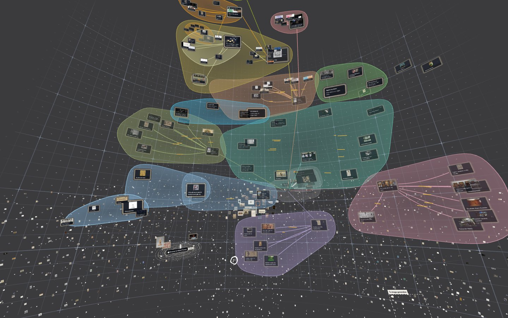

# The walkthrough demo

One prepared tree, "Brainstorming in a headset", for recording the film. It is the walkthrough board made real: 31 rounds of asking, 149 cards, each round a layer of the tree.

- You go to any round from a page on the Mac. The tree then stands on the headset as it was just before that round, and you record from there.
- You talk to Momo as usual. Momo hears you and answers in her own words. What the Scout brings is fixed: the round's cards, in the same order every time, under the same "Scout is searching" labels as a real search.
- Nothing in the app is special-cased. The cards are ordinary cards (pictures, artworks, papers, notes, links), drawn by the app's own card system.




## Where it is

The demo is on the branch `demo/walkthrough`, which holds `tracy/agents` as it stood late on 2026-11-16 (867dcc1: the fist, the knife, the welcome walk's lessons and the looser "Hi Momo") and adds the demo to the service. The app's own code is the same as on `tracy/agents`.

- **On Kai's Mac** it is already checked out, in a second folder beside the main one, so the main folder and the work under way in it are left alone:

  ```bash
  cd <the demo's folder>
  ```

  Every command below is run from that folder. A release APK built from it on 2026-11-16 is at `quest/android/app/build/outputs/apk/release/app-release.apk`; it was installed on Kai's headset that day.

- **On another Mac:**

  ```bash
  git fetch origin && git switch demo/walkthrough && git lfs pull
  ```

## Set up, once

1. **Keys.** `~/.muse-garden.env` needs two lines: `MODEL_API_KEY=...` and `OPENAI_API_KEY=...`. Without the OpenAI key the demo runs but Momo can neither hear nor speak, and the page says "Momo's voice off". On 2026-11-16 Kai's Mac had the first and not the second.
2. **The service's packages.**

   ```bash
   cd agents && npm install
   ```

3. **The app on the headset.** The demo needs nothing special in the app: any copy that is up to date with `tracy/agents` will do. It is recorded on the everyday copy, "Mind Palace Ocean", which is the one kept up to date. To build and install it from this folder, with the headset on the cable, from the repository's root:

   ```bash
   quest/tools/run.sh --build --release
   ```

   That installs over the copy already there and keeps its files (on Kai's headset this was done on 2026-11-16). A headset that never had the app also needs its sounds, fonts and library, about 900 MB, once: `quest/tools/push_media.sh`. Both need two folders git does not hold: `quest/vendor` (`quest/tools/fetch-voice.sh` downloads it, 78 MB) and `media-src/quest/works-small` (`quest/tools/works_small.sh` makes it). In the second folder on Kai's Mac both are links to the main folder's.

   To build the APK without a headset:

   ```bash
   source quest/tools/env.sh && cd quest/android && ./gradlew assembleRelease -PoceanScene=ON
   ```

   It lands in `quest/android/app/build/outputs/apk/release/app-release.apk`, and installs with `adb install -r`.

   Kai's headset holds other copies too. "Mind Palace Ocean (agents)" there is an older build signed on another Mac, which a build from this Mac cannot be installed over: the demo does not use it. Another copy is used by naming its suffix, for example `QUEST_APP_SUFFIX=.film` before the commands here for the filming copy.

## Each recording session

1. **Start the service in demo mode.**

   ```bash
   cd agents && npm run demo
   ```

   It prints two addresses. The one marked `demo` is the control page. It keeps its own data folder, `agents/data-demo`, so your real mindstorm is never touched.

2. **Join the headset**, from the repository's root, with the headset on the cable:

   ```bash
   agents/demo/headset.sh
   ```

   It starts the app on the headset joined to the demo service, and the page's "Headset joined" light turns green. To go cable-free after that, run `agents/demo/headset.sh wifi` (the cable is needed this once), and `agents/demo/headset.sh resume` after the headset slept.

3. **Open the control page** on the Mac: the `demo` address the service printed (`http://localhost:8787/demo#token=...`).

When the recording is over, put the app back on the hosted service, or it will go on looking for the demo on this Mac each time it is opened:

```bash
agents/demo/headset.sh back
```

## Recording a round

1. On the page, click a round: on the chart, or in the list on the left, which is the recording order. The right column shows what to do and say in it, the card it is asked from, and the cards that will arrive.
2. Press **Go to this round**. The bar counts the rounds as they are built on the headset: about half a second each, and 13 seconds for the whole tree. When it is done the headset stands on the layer where the round begins, with the round's card not yet opened.
3. Start recording. Do the steps under "You do", then say the line under "You say", or say it in your own words. Whatever you ask next brings this round: Momo says a few words, the Scout's labels run under her, the cards land dashed as suggestions, and Momo tells you about them.
4. For the next take of the same round, press **Set this round up again**.

Three more controls:

- **Play it now, without a word** plays the round with no voice: the headset goes to the card and the round arrives. Use it when you do not want Momo in the take, or when she answers a line without starting a search.
- **Empty stage** takes the tree away, for recording Round 1, and starts the app again on the headset (see below). **Whole tree** builds everything.
- **Rounds are scripted**, off: the next request is answered by the real Scout, live. On again: the next request brings the next round.

### Recording Round 1

Round 1 starts the tree, so the stage must be empty. Press **Empty stage**. A headset keeps showing a tree after it is deleted, so the service also starts the app again on the headset, which takes about two seconds: you will see the app close and open with nothing standing. If the page says it could not, do it by hand:

```bash
agents/demo/headset.sh restart
```

Then say the line. "Start a tree on ..." always works; the line as written ("let's jam on how we brainstorm with VR headset") relies on a note Momo is given in demo mode, which has not been tried with the live voice yet. The note also gives her the tree's subject, "How we brainstorm with a VR headset", so the first card reads the same in every take. However the tree is started, it is named "Brainstorming in a headset".

## What is fixed and what is live

| Fixed by the script | Live |
|---|---|
| Which cards a round brings, their words, pictures and order | Momo's hearing and everything she says |
| The step labels ("Checking what you already have", "Searching Wikimedia Commons", "Making a picture of ...") | When she decides to search, and on which card |
| The questions offered under the card a round is asked from | The questions under every other card |
| Each card's look | Anything you ask after the last round, or with scripting off |

How a request finds its round:

1. A question the script names (the four under "How do we build this") plays its round, whenever it is picked.
2. A request on the card a round is asked from plays that round.
3. Any other request plays the next round in order, on whatever card you asked on. You are followed, not the script, so a take never fails because a different card was open.

A stray request therefore also brings the next round. If that happens, go to the round again.

## When something is off

| What you see | What to do |
|---|---|
| "No headset joined" | Run `agents/demo/headset.sh` again. On Wi-Fi, after the headset slept: `agents/demo/headset.sh resume`. |
| "Momo's voice off" | `OPENAI_API_KEY` is missing from `~/.muse-garden.env`. Add it and start the service again. |
| The headset shows the tree flat, on one layer | It joined after the tree was built. It is set up again by itself a second after joining; if not, press Go to this round. |
| An old tree stays on the headset after Empty stage | Start the app again: `agents/demo/headset.sh restart`. |
| The app on the headset shows your real trees, not the demo | It is joined to the hosted service. Run `agents/demo/headset.sh`. |
| After the recording, the app shows nothing and Momo does not answer | It is still looking for the demo on this Mac. Run `agents/demo/headset.sh back`. |
| Momo answers but no cards come | Press Play it now, without a word. |
| The wrong round arrived | Press Go to this round. |
| The page says the service is not answering | The service stopped: `cd agents && npm run demo`. The tree is kept in `agents/data-demo` and is taken up where it stood. |

## Trying it without a headset, or without keys

```bash
cd agents && npm run demo:fake
```

runs the demo with stand-in roles: no model, no voice, no cost. The page, going to rounds and playing them all work.

The Mac preview of the app joins the same way as a headset (build it first with `quest/desktop/build.sh`):

```bash
quest/desktop/preview -agent ws://127.0.0.1:8787 -agentToken "$(cat agents/data-demo/token)" -cards -mute
```

`cd agents && node --no-warnings --import tsx --test test/demo.test.ts` runs the demo's own tests.

## Changing the tree

Everything the demo shows is in two places:

- `agents/demo/script.json`: the rounds in recording order. Each has `head` (the card it is asked from: a card of an earlier round, or `root`), `say`, `do`, `offers`, an optional `ask` (an offered question that plays it), and `cards`. A card has `kind` (picture, artwork, paper, film, note, link, facts, person, list), `origin` (`ocean` for your own things, `external`, `generated`), `title`, `text` (one or two sentences: Momo tells the user this, and it is a picture's caption), and where it has them `by`, `date`, `from`, `href`, `image`, `w`, `h`.
- `agents/demo/media/`: one picture per card, and one film.

Edit `script.json` by hand for small changes, then start the service again. Two rules the service holds a tree to: no two cards with the same title, and no two with the same address (`href`).

The file was generated from the walkthrough board by `sketches/walkthrough/gen/demo_inventory.py` in the main folder on Kai's Mac, which is not in git (the board's working files live only there). Run again, it writes into this branch's folder. `demo_phases.json` beside it says which card each round is asked from. Where the board names the card ("Pinch the memory palace paper") that card is the head; where it does not, the head is Claude's choice, and each round's "About this round" on the page says which.

## How it works

- `agents/src/demo/script.ts` reads and checks the script. `cards.ts` makes each card the item and node the service keeps, so the usual rules choose its look.
- `director.ts` does the rest. **Going to a round** deletes the tree's cards and builds the earlier rounds again, kept. A headset decides its own layers from what is asked on it, and cards that all arrive at once land on one layer, so the director takes the headset through the rounds in order: it goes to a round's card, waits for the headset to open it, adds the round's cards, and waits for the headset to give them their layer. **Playing a round** is the Scout role replaced: `Pipeline.runScout` runs as ever (the run's label, the deliveries, the closing line, Momo's narration), and the director hands it the round's cards in place of a search.
- The service's own code changed in five small places: `--demo` in `main.ts`; the director's wiring, the page's routes under `/api/demo` and the page at `/demo` in `server.ts`; `stage`, `go` and `forget` on `Pipeline`; a round's limits as a parameter of `admit` (a prepared round holds up to 13 cards, a live one 10); and `extra` instructions for the live voice.
- The page is `agents/client/demo.html`, `demo.css` and `js/demo.js`.
- `agents/demo/headset.sh` is the headset's side: it runs `quest/tools/agent.sh` and `judging.sh` for the everyday copy with the demo's data folder. The service runs its `restart` itself for an empty stage (`restartHeadset` in `main.ts`), with adb on this Mac.

## What has and has not been tried

**On Kai's headset, 2026-11-16** (a Quest 3 on the cable, lying on a desk and told it was worn; the release build from this branch installed over "Mind Palace Ocean"; the service with the real model and no voice):

- Going to a round: seven rounds built in 3.0 seconds, the whole tree (31 rounds, 150 cards) in 13.0, back from the whole tree to Round 3 in 3.5. Each round stood on its own layer, as the app's own log and pictures of its screen showed.
- The empty stage: one press, and the app was started again and had joined with nothing standing 1.4 seconds later.
- Playing a round from the page: Round 1 started the tree and its twelve cards arrived in four parts over ten seconds, dashed, tagged "Suggested", with "Scout" and "Renderer" lines by Momo's mark.
- A request made on the headset itself: the app was told by a launch flag to hold a pinch on its open card (`-longPinchAt`), which sent "more like this" as a hand does, and the next round arrived there and the view followed.
- Requests as the headset sends them, from a test connection: a long pinch on "Neurones poster" brought "More of this" in 5 seconds, and the words "so how do we keep the information organized?" with Llull's ring open went through the real Conductor ("Looking at how to keep this information organized.") and brought Round 3 in 8.
- The service stopped and started again took the tree up where it stood, and the headset joined again by itself.

The Mac preview of the app, built from this branch, showed the same on 2026-11-16 (pictures above and below). The service's tests pass: 704, with one that is skipped without a key; eight of them are the demo's.


Not tried:

- **Momo's live voice in demo mode.** Kai's Mac has no OpenAI key, so on it Momo neither hears nor speaks. The note that makes each line a take (`momoNote` in `director.ts`) has never met the real model.
- **A person's hands.** Nobody wore the headset: pinching a card open, keeping a pick, tapping an offered question and "Hey Momo" were not done by hand or voice.
- **The film card.** "Disney's multiplane camera" carries its file (from 2:43 of the source) and shows its poster and play mark on the headset; whether it plays there when the card is gone into was not checked.
- **The mark on the Linux picture.** It is a real stroke on the card; its place was set by calculation, and it is drawn only once the card is gone into.

Seen on the way, and left as they are: the first card of a tree started by voice reads "From: You pasted this" (the service marks every tree started from a subject that way), where one set up from the page reads "You said this"; and before Round 1 the app shows its own three example asks, which are about films.

The pictures are for the film's planning: many are other people's work, in copyright or of unknown rights (pins, film stills, a paper's figure). The repository is private; clear each one before a public cut.
