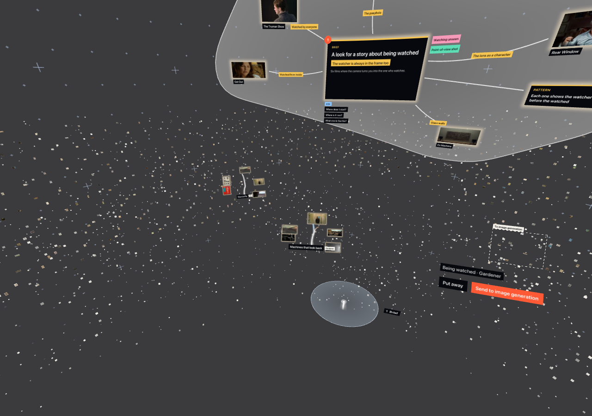

# The headset app

The Mind Forest app for Meta Quest 3. It is a native Android app in C++ on OpenXR, with passthrough and hand tracking and no game engine. Its renderer is OpenGL ES, written for what the app draws: unlit pictures and text, threads, dust, a hover glow and video.

The app shows your trees of cards in the room and reads your hands. It is a client of the agent service in [agents/](../agents/README.md): the service decides what cards exist and how each looks, and the app draws them and sends back what you do.

Working notes on every part, with all the launch flags and the numbers behind each gesture, are in [NOTES.md](NOTES.md). This page is the overview.

## What you see

- **The desk.** The app reads the room's tables through OpenXR and squares the scene to the edge of the desk in front of you. With no scanned room or no permission, it assumes a desk.
- **The forest.** Trees that are put away stand on the desk around you, each about a metre tall with its name at its foot, a few of its pictures round it, and raked rings on the ground. A tree keeps its place between launches.
- **A tree.** Opened, a tree stands in front of you in layers. Each card you ask about leads a new layer, and the layers you came through stay behind the one you work on. A small tree of light on the desk shows the layers and lets you jump between them.
- **Cards.** A card from the service is drawn as one of 28 card types (a note, a quote, a picture, a video, a table, a chart and so on), at sizes worked out for reading at 1.5 m ([core/cards/README.md](core/cards/README.md)). A suggestion from the agents hangs on a dashed thread until you keep it.
- **The library.** Beyond the desk lies the library: film scenes and museum works as small pieces all round you.
- **Momo.** The assistant sits low in front of you as a white ring with two eyes. Your words show beside it in white as it hears them, and its reply in amber as it speaks. While agents work, a small line for each says what it is doing, such as "Scout · Searching museum collections".



## The gestures

Hands only. Controllers do nothing. The Quest 3 has no eye tracking, so a ray from each hand aims every pinch, and a small dot shows where it lands.

| Gesture | What it does |
|---|---|
| Pinch a card | Opens it where it stands |
| Pinch the open card again | Goes into it. Pinch it once more, or pinch empty space, to step back |
| Pinch a card and hold still for 0.4 s, while a ring fills | On a card with nothing under it: starts a layer on it and asks for more like it. On a card with cards under it: goes into its layer |
| Pinch and drag a card | Moves it, and it stays where you put it |
| Pinch a question under the open card | Asks Momo that question. At most three are shown |
| Close a fist and pull or push | Steps between layers |
| Close a fist and move it sideways | Carries the whole tree |
| A finger along the small tree, then pinch | Chooses a layer |
| A flat hand held on its edge | A blade of light comes out. Slice across a thread, then slice again to confirm, and the thread is cut |
| Palms held together for one second | Closes the tree you are in and puts it away |
| Point at a tree on the desk | Send and Share appear over it (below) |
| Pinch a tree on the desk | Opens it |
| Pinch a piece of the library | With no tree open, asks Momo for a tree about it |

A light is drawn on the hand for the gestures that need feedback: a gauge round a closed fist, a ring that fills while a pose is held, the blade and the mark where it cuts.

**On a card you have gone into**, three buttons stand at the top right of its picture:

- **The pen.** Pinch it to take it up. With the pen up, a drag marks the card and does not scroll: on words it highlights them, on a picture it draws, along a video it marks a stretch. With the pen down, a drag scrolls the card.
- **The eraser.** One press takes every mark off the card.
- **Send to Momo.** Asks Momo about all the card's marks together.

The service keeps the marks with the card, so they come back on another headset, and "undo" takes back the last change.

**On a tree on the desk**, pointing at it shows two square buttons side by side over its crown:

- **Send to Agents** asks the service for the tree's handoff, which arrives in the paired Telegram chat as one Markdown file.
- **Share with Friends** shares the tree (see [Share with Friends](#share-with-friends) below).

**The guide.** On a first launch a welcome tree gives eight lessons, one card each. Six teach a gesture, with a hand that plays it on the card, and two are done by talking to Momo. Afterwards a small ghost hand shows a gesture at the moment it becomes useful, and a Gestures button lists them all.

## Share with Friends

What Share with Friends does depends on the service.

- **On the hosted service**, whose hello says `"share":"telegram"`, it asks at once and stays lit until the service answers. Taken, it says "Sent to your Telegram": the service posts a link in your chat, and a friend who opens it gets a copy of the tree in their own forest. Refused, it says why for 1.8 s, such as "Pair Telegram first", and nothing goes.
- **On a service that does not share through Telegram**, it opens a list of people under itself, each a round picture and a name. In this repository their pictures are drawn placeholders (`media-src/quest/people`, which `tools/push_media.sh` sends to the headset). Pinching a name shares the tree and the button says "Shared with" and the name. Pinch Share again, or anything else, to shut the list; left alone for 2.5 s it goes with the buttons. A share the service refuses says "Not shared".

When a share is taken, a copy of the tree's light lifts off the tree, sways, and the wind carries it out of view. The list and the copy are in `core/ocean/oceanmodel_share.cpp`, and the buttons are drawn by `showButtons` in `core/ocean/oceanmodel_desk.cpp`. In the Mac preview: `-hoverCover <i> -hoverCoverAt <s> -coverButton share -coverButtonAt <s> -sharePick 0 -sharePickAt <s>`.

## Talking to Momo

- The app listens for "Hey Momo" or "Hi Momo" on the headset itself, with sherpa-onnx's keyword spotter. Nothing is sent before it hears the name.
- The name opens a conversation. While it is open you talk without the name, and you can talk over Momo, which stops it at once. The conversation closes after 8 s with nobody talking.
- The service checks the second of sound that woke the headset. If it does not hold the name, the turn is dropped before Momo says or does anything.
- Momo's voice streams back and plays as it arrives. The microphone uses Android's echo cancelling so Momo's own voice is not taken for yours.
- Momo has three sounds of its own: a chime when it hears the name, a short tone when your turn is sent, and a quiet loop while it thinks.
- Without a microphone, you can still pick the questions under a card and type with the system keyboard.

## How it talks to the service

The app is a client of version 1 of the service's protocol ([agents/docs/protocol.md](../agents/docs/protocol.md)). The code is in `core/agent/`.

- **One WebSocket, `/ws`,** carries the state and what you do. The service sends a snapshot and then change sets. The app keeps a copy (`mirror.*`) and draws it. What a hand does goes back as a message: `focus`, `ask`, `more`, `keep`, `commands` (moving, deleting and marking cards), `handoff`, `share`.
- **A second WebSocket, `/live`,** carries the voice: the microphone at 16 kHz one way, Momo's voice at 24 kHz the other, with frames that say when a turn starts and ends.
- **Pictures and video** come from the service over HTTP. A video file plays in its card.
- **The token** goes on every request. A developer build uses the service's own access key. The judging build sends an app key with a device id it makes on its first launch, so the hosted service keeps each headset's trees apart.
- **Reconnecting.** A lost connection is tried again after 1, 2, 4 and 8 s, then every 15 s.
- The app tells the service when the headset is put on again (`worn`), which is when a tree a friend shared grows.

Every message the app can send is checked against the service's own schema by `core/agent/test/run.sh`.

## Build and run

On a Mac. You need:

- the Android SDK in `~/Library/Android/sdk`, with platform 34, build-tools 34, NDK 27.2 and CMake 3.22;
- JDK 17 (`brew install openjdk@17`);
- a Quest 3 on a USB cable with developer mode on;
- the keyword spotter, fetched once:

```bash
quest/tools/fetch-voice.sh
```

Build, install and start:

```bash
quest/tools/run.sh --build
```

The media is not inside this APK. Copy it to the headset once after the first install. Later runs send only what changed:

```bash
quest/tools/push_media.sh
```

`push_media.sh` reads the library from `library/` (`ocean.json`, `clips`, `works` and a note's picture in `notes`), and the app's own media from [media-src/quest](../media-src/README.md).

Join the app to the service running on the Mac:

```bash
(cd agents && npm start)
quest/tools/agent.sh usb
```

`agent.sh wifi` moves adb to Wi-Fi so the cable can come out, `agent.sh resume` reconnects after the headset slept, and `agent.sh forget` makes the app forget the service. The app remembers the service it last joined and joins again when started from the app library.

Other commands:

```bash
quest/tools/run.sh -- -demo -mute     # start with launch flags
quest/tools/run.sh --build --release  # the release build
quest/tools/run.sh --log              # follow the app's log
```

### The judging build

One APK that a judge installs and opens, with nothing to set up: "Mind Forest", `com.kaifengwu.mindpalace.ocean.judge`.

```bash
quest/tools/judge.sh             # build it and check its id, name, signature and media
quest/tools/judge.sh --install   # and install it on the connected headset
```

- It carries its media inside, about 780 MB, so nothing is copied at first launch.
- It joins the hosted service named in `~/.mind-palace/judging.properties` by itself.
- It is release-signed with a key in `~/.mind-palace/keys`. Neither file is in the repository.
- When it cannot reach the service, Momo's caption says "Can't reach Momo, retrying".

`quest/tools/judging.sh` joins a developer build, or the Mac preview, to the same hosted service.

### The Mac preview

A window with the same scene and renderer, one eye, and the mouse for a hand. It needs GLFW (`brew install glfw`).

```bash
quest/desktop/build.sh
quest/desktop/preview -demo
```

Move the mouse to aim, click to pinch, right-drag to turn the head, scroll to magnify. It has no video and no hand gestures, so launch flags stand in for them. For a picture without a window:

```bash
quest/desktop/preview -walk 3 -shot /tmp/walk.png -shotAt 6
```

The preview joins a service only with flags: `-agent <address> -agentToken <token>`.

## Filming

A third-person shot of someone using the app (an ordinary camera's footage with the scene drawn into it from where
the camera stood) is made from a take the app records with `-film`: see [film/README.md](film/README.md).

## How the code is organised

| Path | What it holds |
|---|---|
| `core/` | What the scene is built on: the scene graph (`scene.h`), drawing text and shapes into a picture (`canvas.h`), the renderer (`render.*`), hand rays and pinches (`input.*`), the sound mixer (`audio.*`), background work (`async.*`), frame timing (`perf.*`), and `platform.h`, the interface each host implements |
| `core/ocean/` | The scene itself. `oceanmodel*.cpp` is the model that everything hangs from, split by concern: the tree, cards, pressing, cutting, marking, the desk, the guide, sound. Beside it: the layers and their layout (`tree.*`, `stage.h`, `grid.*`), the library (`shell.*`, `library.*`, `catalog.*`), hand poses and the light on the hands (`hands.*`, `handglow.*`), the desk and the forest (`desk.*`, `gravel.*`), the guide's hand (`guide*.cpp`), threads, and the small tree (`hologram.*`) |
| `core/agent/` | The client of the agent service: the wire contract (`protocol.*`), the connection (`client.*`, `connection.*`), the copy of the state (`mirror.*`), the bridge between the service's trees and the scene (`bridge.*`), where service trees stand (`plots.*`), listening for the name (`spotter.*`, `listener.*`), the voice (`voice.*`), and Momo's look (`presence_*`, `crew.*`) |
| `core/cards/` | The card library: one file per card type, with the text measuring and painting they share. [Its README](core/cards/README.md) has the API |
| `android/` | The Android project: the OpenXR host in `app/src/main/cpp` (session, passthrough, hands, the room, audio through AAudio) and a Kotlin activity for permissions, text drawing, media, networking and the keyboard |
| `desktop/` | The Mac preview host, and `desktop/test/`, scripted checks that run the preview against a stand-in service |
| `sound/` | `synth.py`, which makes the app's sounds |
| `tools/` | Scripts that build, install, join, push media and measure |
| `perf/` | Saved performance runs and the baseline |
| `preview-shots/` | Pictures taken in the preview |

Two hosts implement `core/platform.h`: `android/` for the headset and `desktop/` for the Mac. Everything under `core/` is shared.

### Tools

| Script | What it does |
|---|---|
| `tools/run.sh` | Builds, installs and starts the app, passes launch flags, follows the log |
| `tools/push_media.sh` | Copies the media to the headset |
| `tools/agent.sh` | Joins the app to the service on the Mac, over the cable or Wi-Fi |
| `tools/judge.sh` | Builds and checks the judging APK |
| `tools/judging.sh` | Joins a developer build or the preview to the hosted service |
| `tools/fetch-voice.sh` | Fetches the keyword spotter and its model into `quest/vendor` |
| `tools/works_small.sh` | Makes small copies of the works' pictures for small cards |
| `tools/perf.py` | Runs a scripted scenario on the headset and reports frame times |
| `tools/check.sh` | Syntax-checks the sources under `core/` with the Mac's clang |
| `tools/wake_measure.sh` | Measures how often the name is heard on spoken clips |

### Tests

```bash
quest/core/agent/test/run.sh
```

Builds the agent client's tests with the Mac's clang, runs them under the address, undefined-behaviour and thread sanitizers, and checks every outbound message against the service's schema.

```bash
quest/core/cards/test/sizes.sh
quest/core/cards/test/pieces.sh
```

Check that every card sample is inside the size rule, and that every piece of the library draws as a card.

The checks in `desktop/test/` each run the preview with launch flags against a stand-in service (`standin.mjs`) and read its log. For example:

```bash
node quest/desktop/test/navigate_check.mjs
node quest/desktop/test/cards_edit_check.mjs
quest/desktop/test/hands_check.sh
```

### Performance

```bash
quest/tools/perf.py
quest/tools/perf.py --compare quest/perf/baseline.json
```

One run is a scripted scenario on the real headset with no hands. `--compare` exits with 1 when a run is worse than the baseline by more than its margins. The baseline, the scripted demo for 60 s at 90 Hz on 14 November 2026, had 1 late frame of 5,131 and CPU time of 2.1 ms at the median.

## Sound

The app's sounds are synthesized by `sound/synth.py`, all in one key (D Lydian) so anything that overlaps agrees. Each layer has a chord, and each card on a layer its own note. The files are in git in `media-src/quest/sounds`, so a clone has them without running the script. While Momo listens, thinks or speaks, the other sounds play about 9 dB lower. `-mute` silences everything.
